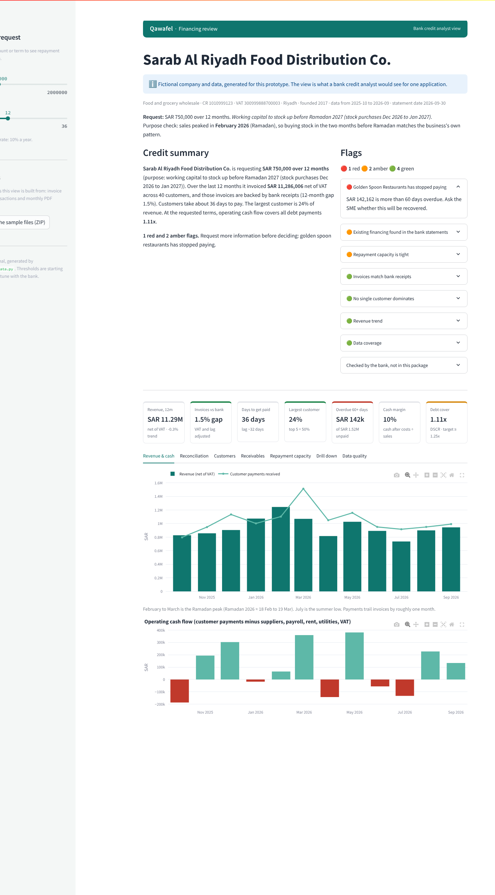

# Qawafel SME Financing Review: prototype

A working prototype of the screen a **bank credit analyst** uses to decide on a financing request from an SME wholesaler on Qawafel. It reads the SME's raw uploads (an invoice export and bank transactions), cleans them, checks that the invoices are backed by real money in the bank, and shows the numbers a credit decision needs, with every number traceable back to a row in the original files.

**Live demo:** https://appwafel-financing-prototype-3354ktx5lpjuh8zk9dpp6r.streamlit.app (no install needed; if it shows "app is asleep", click to wake it, about 30 seconds)



## Run it

```bash
python -m venv .venv && source .venv/bin/activate
pip install -r requirements.txt
streamlit run app.py
```

Then open http://localhost:8501. The sample data is already in `data/`. Run the tests with `pip install pytest && pytest`. To rebuild it: `python src/generate_data.py` (seeded, so the output is the same every time).

Optional: `pip install anthropic` and set `ANTHROPIC_API_KEY` to get a "Write the summary with AI" button for the credit summary. Without it the app uses a rule-based summary. Only computed metrics and flags are sent to the model, never raw invoices or bank lines.

## What the analyst sees

| Section | Question it answers |
|---|---|
| Credit summary + flags | What should I look at first? (red / amber / green, each with the evidence) |
| Purpose check | Does the loan purpose fit the sales pattern? (stocking up before the Ramadan peak) |
| KPI cards | Revenue, invoice-to-bank gap, payment lag, concentration, overdue receivables, cash margin, repayment coverage |
| Checked by the bank | What the files can't prove (credit history, collateral, guarantees, KYC), so the bank checks it from its own sources |
| Revenue & cash | Is the business growing, and is cash moving the way sales say it should? |
| Reconciliation | Are the invoices real? Invoices vs customer payments, month by month, plus the credits we excluded |
| Customers | How dependent is the business on a few buyers? |
| Receivables | Who owes money, and for how long? |
| Repayment capacity | Can it afford the new installment? Change amount and term in the sidebar |
| Drill down | Pick a month and see the exact invoices behind the number, with their row in the source file |
| Data quality | Everything the cleaner changed or flagged. Nothing is changed silently |
| Sample files (sidebar) | Download the raw uploads to compare with what the app shows |

## How it works

`src/engine.py` runs these steps:

1. **Clean invoices.** Convert amounts typed as text, drop exact duplicates, recover missing customer names from the VAT number, and merge one customer written several ways (by VAT number, then by normalised name). Each fix is logged with its Excel row.
2. **Classify bank lines.** Rules on the description separate customer payments from money that is not sales: financing disbursements, owner top-ups, transfers between the company's own accounts, and supplier refunds. Anything no rule recognises is never counted as a sale, and unknown outgoing payments count as costs, so the numbers err on the cautious side. Both are listed for the analyst.
3. **Allocate payments to invoices.** A payment that quotes invoice numbers (SADAD batches list several) is split across them, oldest first. An invoice is marked paid only when the money covers what is owed (after credit notes). Partial payments keep the rest open in receivables, and money that can't be allocated is reported, not dropped. Receivables follow the bank, not the SME's file: a "Paid Date" in the upload is treated as the SME's claim, and if the bank shows less, the invoice stays open and is flagged. Payments without a reference match an unpaid invoice of exactly the same amount issued 0 to 150 days earlier.
4. **Reconcile.** Compare invoices *including VAT* (customers pay the VAT too) with *customer payments only*, shifted by the payment lag. The gap is checked over 12 months and over rolling 3-month windows.
5. **Estimate repayment capacity.** DSCR = average monthly operating cash flow / (existing debt payments + the new installment), plus the same ratio for the weakest 3 months, because an average hides seasonal dips. It's an estimate from bank statements, not a verified underwriting ratio.
6. **Flag.** Thresholds turn the metrics into red / amber / green flags.

The 1.5% gap compares totals, so the Reconciliation tab also shows how much of the customer money is matched to specific invoices (92%) and how much isn't (8%, mostly in the first months, which fits payments for invoices issued before the upload). It also shows the naive check (net invoices vs all bank credits, −18.7% here). It suggests more money came in than was invoiced, which would hide fake invoices. That gap is just VAT, the loan, owner money and own-account transfers.

## The sample company

**Sarab Al Riyadh Food Distribution Co.** is fictional: a Riyadh food wholesaler asking for SAR 750k over 12 months to stock up before Ramadan. All names, numbers and IDs are made up. The data was built to tell a story an analyst has to think about:

- About SAR 11.3M in yearly sales with a Ramadan peak and a summer dip. The sales reconcile with the bank (12-month gap 1.5%).
- One restaurant chain stopped paying in April 2026 and owes about SAR 142k (**red**).
- A SAR 400k financing disbursement shows up in the bank, so the SME already has debt (**amber**).
- Operating cash flow is about SAR 94k a month (a 10% cash margin). Repayment coverage is 1.11x at 12 months (**amber**) and 1.48x at 18 months, but the summer months barely cover the payments, so the analyst may want a seasonal repayment schedule.

The files are messy on purpose, like a real export: three spellings of one customer (one in Arabic), duplicates, missing names, amounts typed as text, missing paid dates, and SADAD batch payments. The "right answers" are in `data/_ground_truth_*.csv` so the cleaner can be checked.

| File | What it is |
|---|---|
| `data/invoices_2025-10_to_2026-09.xlsx` | Invoice export, 12 months |
| `data/bank_transactions.csv` | Bank transactions, same period |
| `data/bank_statements/*.pdf` | The same transactions as monthly PDF statements (what an SME would really upload; the prototype reads the CSV) |
| `data/company.json` | Company details and the financing request |

## Assumptions and limits

- Thresholds (gap 10%, largest customer 30%, overdue SAR 100k, DSCR 1.25 / 1.0) and the 10% profit rate are starting points, to be agreed with the bank partner.
- Payment lag is the amount-weighted median days to pay, so many small cash sales don't hide slow big buyers.
- Bank credits are classified with simple description rules. Real statements would need per-bank rules plus a "needs review" queue for the analyst.
- The prototype reads CSV/XLSX only. Parsing bank PDFs, open banking, and live accounting connections are out of scope here.
- The app handles messy *values* (text amounts, duplicates, name variants) but expects this export's column layout. Real uploads need the column-mapping step from Task 1 (risk A1), so there is no upload button.
- Cash margin is a cash proxy (operating cash flow ÷ net sales), not accounting profit, which would need the SME's financial statements.
- Amounts are calculated as floating-point numbers and rounded to halalas for display. Production code would store and sum money as fixed decimals (`DECIMAL(14,2)`, as in the technical spec).
- No login, database or audit trail. In production those come from the platform in the technical spec.

## Project layout

```
app.py                 Streamlit dashboard
.streamlit/config.toml theme colours
src/engine.py          cleaning, classification, matching, metrics, flags
src/summary.py         rule-based and optional AI credit summary
src/generate_data.py   builds the fictional sample data
data/                  sample uploads + ground truth
tests/test_engine.py   payment allocation, cleaning vs ground truth, repayment maths
```

## Tests

`tests/test_engine.py` covers the cases that matter for a lending decision: partial payments, payments split across a batch, overpayments, amount-only matches, two invoices with the same amount, credit notes, zero payments, an SME file that says "paid" when the bank shows otherwise, and that the cleaner's output matches the ground-truth files (duplicates, text amounts, merged customers, bank classification, operating costs). Writing the tests caught a real bug: suppliers with no keyword in their name were left out of costs, which flattered repayment capacity. Unknown outgoing payments are now counted as costs. GitHub Actions runs the tests on every push.

**Why the sample data changed after that fix.** Once every supplier payment was counted, the generator's original assumptions (supplier costs at 80% of sales and a SAR 36k/month existing loan) left the fictional company with a 2% cash margin. That's too thin to be a believable applicant for a SAR 1.2M loan, so the scenario was wrong, not just the code. I recalibrated the made-up inputs to a more typical distributor (73% supplier costs, so about a 10% cash margin, and a SAR 18.5k/month existing loan) and lowered the request to SAR 750k. The engine and thresholds were not tuned to hit a result: the same code would flag the old scenario red.
